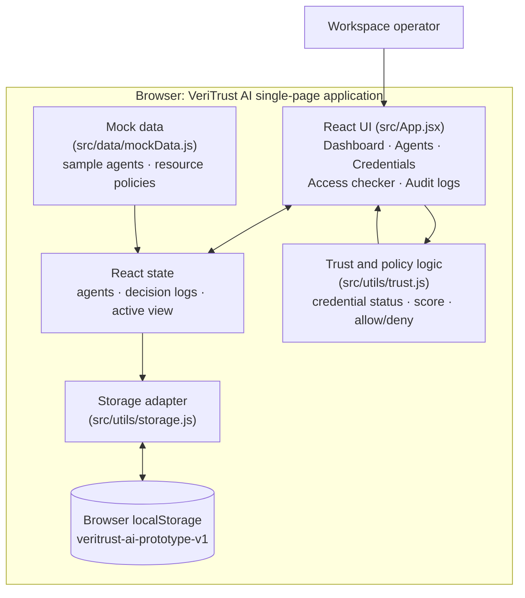
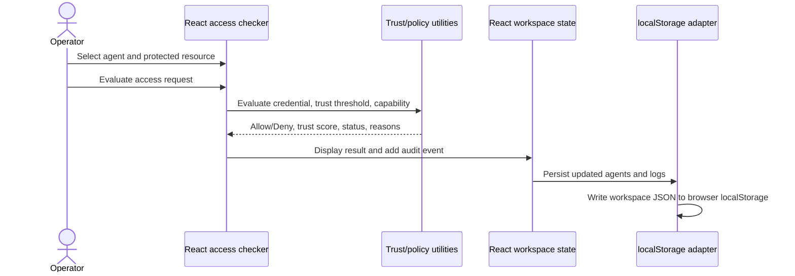

# VeriTrust AI

VeriTrust AI is a local, browser-based prototype for managing AI-agent identity records, simulated credential status, trust scores, resource access decisions, and audit history. It is designed to demonstrate an identity and authorization control plane and provide a basis for a system architecture diagram.

> **Prototype boundary:** The application uses sample data and browser `localStorage`. It has no backend, API, database server, blockchain connection, cryptographic credential verification, or real identity provider. DIDs, credentials, trust factors, policies, and audit events are illustrative demo records.

## Features

### Dashboard

- Workspace summary: registered agents, valid credentials, average trust score, and access decision totals.
- Agent trust profile with score bands and credential status.
- Credential coverage/security posture summary and shortcuts to the access checker and audit log.
- Recent access decisions.

### Agent management

- Browse registered agents and their DID, owner, trust score, credential status, and registration date.
- Search by agent name, DID, or owner; filter by credential status.
- Register an agent with its name, organization, purpose, credential issuer, and expiry date.
- Assign a **sample** `did:web` identifier, demo credential ID, default capability, and initial trust factors to a newly registered agent.
- Validate that a new credential expiry date is not in the past.

### Credential verification

- Display credential totals by Valid, Expired, and Revoked status.
- Search by agent, credential issuer, or credential ID; filter by status.
- Derive status from the demo credential's expiry date and revocation flag. This does **not** verify signatures or consult a revocation registry.

### Trust scoring and access checking

- Calculate an agent trust score out of 100 from four factors:
  - Identity verification: up to 30 points.
  - Credential validity: 30 points when valid; otherwise 0.
  - Access history: up to 20 points.
  - Observed behaviour: up to 20 points.
- Select an agent and a protected resource to evaluate an access request.
- Evaluate three policy conditions: credential is valid, trust score meets the resource minimum, and the agent has the required capability.
- Return an Allow or Deny decision with the trust score, credential status, and human-readable reasons.
- Show the selected resource's classification and policy requirements.

### Audit logs

- Automatically record each access check, including outcome, agent/resource identifiers, reason, trust score, and timestamp.
- Search audit records and filter by outcome or starting date.
- Show summary counts and the latest decisions on the dashboard.

### User interface

- Five in-app views: Dashboard, Agent management, Credential verification, Trust & access checker, and Audit logs.
- Responsive layout with collapsible mobile navigation, tables, status indicators, empty states, and registration dialog.
- Reduced-motion preference support and visible keyboard focus styles.

## Technology stack

| Area | Technology |
| --- | --- |
| Language | JavaScript with native ES modules |
| UI | React 19 (`react`, `react-dom`) |
| Build/development server | Vite 6 |
| React integration | `@vitejs/plugin-react` |
| Styling | CSS in `src/index.css`, with Tailwind CSS 4 and `@tailwindcss/vite` configured |
| Icons | `lucide-react` |
| Persistence | Browser `localStorage` (no server-side storage) |
| Typography | Manrope and DM Mono, imported from Google Fonts with system fallbacks |
| Runtime | Node.js 18 or newer and npm |

The package manifest is the source of truth for dependency versions and ranges.

## Architecture overview

The current application is a single-page frontend. React components own the views and workflows; utility modules hold trust/policy calculations and local persistence; mock data supplies initial agents and resource policies.



**No backend or blockchain is part of the current runtime.** In an architecture diagram, show any API, database, credential issuer/verifier, DID resolver, or blockchain as a **future integration**, not as an existing application dependency.

## Access decision flow



## Data and policy model

- **Agent:** demo ID, name, DID string, owner, purpose, capabilities, credential, trust factors, and creation timestamp.
- **Credential:** issuer label, credential ID, expiry date, and revocation flag. It is not a signed verifiable credential.
- **Trust factors:** identity (maximum 30), history (maximum 20), and behaviour (maximum 20); credential validity contributes 30 points.
- **Resource policy:** resource name and classification, minimum trust score, required capability, and a descriptive policy string. The three sample resources are Internal Knowledge Base, Customer Profile API, and Production Release Pipeline.
- **Audit event:** decision ID, agent ID, resource ID/name, decision, reason, trust score, and timestamp.
- **Persistence boundary:** the workspace `{ agents, logs }` is serialized to one browser localStorage entry. It is scoped to the browser profile/site and can be cleared with site data.

## Project structure

```text
.
├── index.html                 # HTML entry point and app metadata
├── package.json               # Scripts and dependencies
├── vite.config.js             # Vite, React, and Tailwind CSS plugins
└── src/
    ├── main.jsx               # React application bootstrap
    ├── App.jsx                # Navigation, screens, forms, and user workflows
    ├── index.css              # Theme, layout, component styling, responsive rules
    ├── data/
    │   └── mockData.js        # Initial sample agents and resource policies
    └── utils/
        ├── trust.js           # Credential status, scoring, breakdown, policy check
        └── storage.js         # Browser localStorage load/save adapter
```

## Run locally

Requirements: Node.js 18 or newer and npm.

```bash
npm install
npm run dev
```

Open the local URL printed by Vite. To create and preview a production bundle:

```bash
npm run build
npm run preview
```

## Current limitations and future architecture boundaries

- Sample DIDs and credentials are generated/stored as plain demo data; there is no DID resolution, key management, issuer authentication, signature validation, or cryptographic proof.
- Revocation and expiry status use fields in local data; no external status list or revocation registry is consulted.
- Trust values and resource policies are local static/demo values; access decisions are illustrative and are not enforced by protected services.
- The browser's localStorage is not a secure or shared system of record. There is no authentication, role-based operator access, server audit trail, synchronization, or multi-user workspace.
- A production architecture could replace the storage adapter with an authenticated API and persistent database, and add a real DID/credential verification service and protected-resource enforcement. These are proposed extension points, not implemented features.
