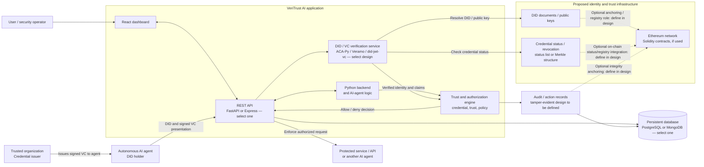
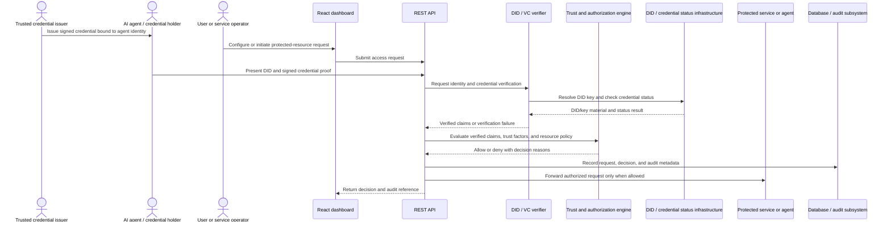
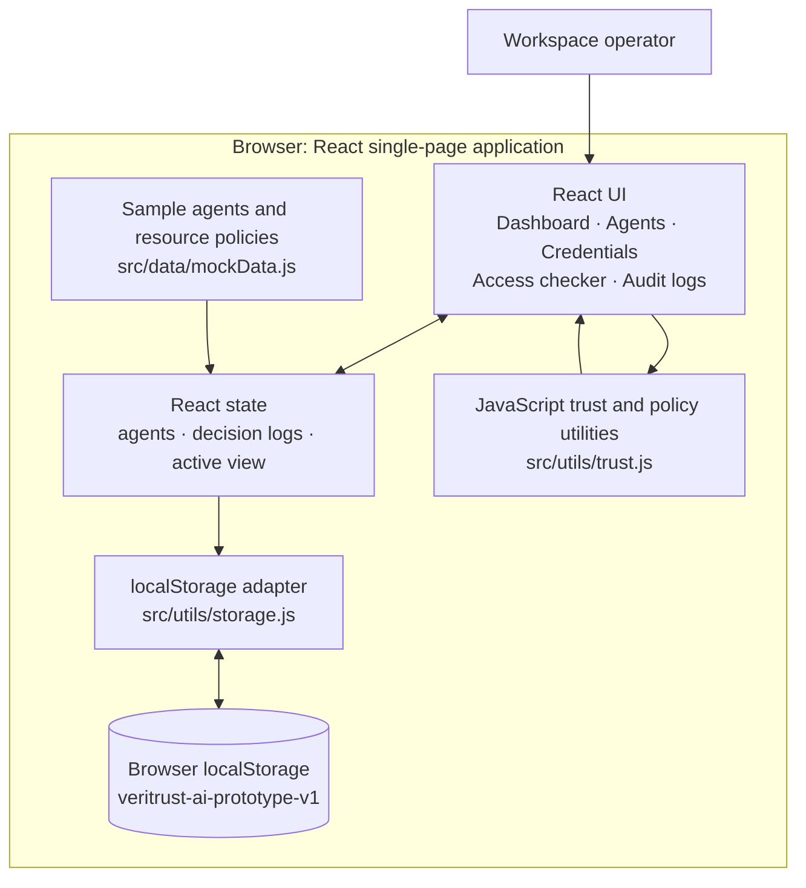
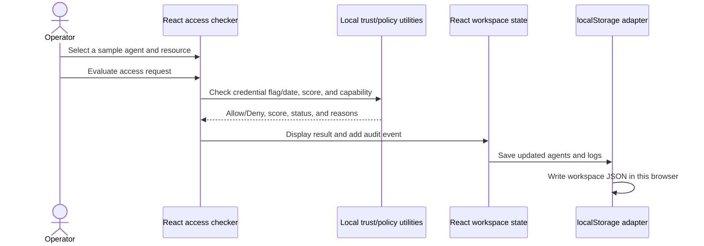

# VeriTrust AI

**Project title:** A Trust-Based Verifiable AI System Using Decentralized Identity and Verifiable Credentials

VeriTrust AI is a B. Tech. project in Software Development and Security. Its proposed system gives autonomous AI agents decentralized identities, enables them to present verifiable credentials, and evaluates their trust and authorization before granting access to protected services or other agents. The project is intended to demonstrate secure, accountable, and interoperable identity and access management for AI agents, based on open identity standards.

> **Implementation status:** This GitHub repository currently contains a frontend demonstration, not the complete proposed system. The implemented prototype uses mock records, local JavaScript trust/policy calculations, and browser `localStorage`. The backend, AI-agent runtime, cryptographic DID/VC verification, SSI framework, database, API, and blockchain described below are proposed technologies and architecture from the project synopsis; they are not currently integrated into this codebase.

## Project context

- **Application domain:** Software Development, Security
- **Sustainable Development Goal:** SDG 9 — Industry, Innovation and Infrastructure
- **Core problem:** Static, centrally managed API keys, passwords, and tokens are not a complete identity and authorization model for autonomous, distributed, and sometimes temporary AI agents.
- **Proposed approach:** Use decentralized identifiers (DIDs), verifiable credentials (VCs), cryptographic verification, trust-based authorization, and traceable records to establish and evaluate agent identity and permissions across systems.
- **Standards foundation:** W3C Decentralized Identifiers and Verifiable Credentials; Self-Sovereign Identity (SSI) and issuer–holder–verifier concepts.
- **ACM-style keywords:** Authentication, Access Control, Decentralized Identity, Verifiable Credentials, Distributed Systems Security, Public Key Infrastructure, Trust Frameworks, Multi-Agent Systems.

## Objectives in the synopsis

1. Study AI-agent trust mechanisms, decentralized identity standards, and verifiable credential technologies.
2. Design a trust-based AI system architecture using DIDs and VCs.
3. Develop a prototype in which AI agents establish verifiable identities and present credentials.
4. Implement identity verification, credential validation, and trust-based authorization for agent interactions with users, services, and other agents.
5. Validate the system with functional tests and representative use-case scenarios.

## Features

### Implemented in this repository (frontend prototype)

- **Dashboard:** Registered-agent and credential counts, average trust score, access-decision totals, credential coverage, agent trust profiles, and recent decisions.
- **Agent management:** Browse, search, and filter sample agents; register an agent with owner, purpose, issuer, and credential expiry details.
- **Sample identity generation:** Assign a demo `did:web` string, credential ID, default capability, and initial trust factors when registering an agent.
- **Credential status view:** Search and filter demo credentials; calculate Valid, Expired, or Revoked status from an expiry date and revocation flag.
- **Trust scoring:** Calculate a score out of 100 from identity (30), credential validity (30), access history (20), and observed behaviour (20).
- **Access checker:** Evaluate a selected agent against a resource's credential validity, minimum trust score, and required capability; show Allow/Deny and reasons.
- **Audit log:** Record each local access evaluation with outcome, agent/resource, reason, trust score, and timestamp; search and filter the results.
- **Responsive interface:** Five dashboard views, mobile navigation, registration dialog, status indicators, empty states, keyboard focus styling, and reduced-motion support.

These prototype records and decisions are illustrative. They are not proof of identity, cryptographic verification, or enforcement at a protected service.

### Proposed capabilities in the synopsis (not yet implemented here)

- Issue, hold, present, and verify signed credentials for AI agents using an SSI-compatible identity and credential layer.
- Verify agent identity and authorization without relying solely on a single centralized identity provider.
- Apply fine-grained, credential-based trust and access policies to interactions with users, services, and other AI agents.
- Support cryptographic authentication, credential integrity, revocation/status checking, and traceable, tamper-evident action records.
- Evaluate the system with functional tests and real-world-inspired scenarios, including valid, expired, revoked, and insufficient-trust credentials.

## Technology stack

The synopsis describes the intended project stack. Several entries are alternatives or research options rather than final selections. The **implemented now** column identifies what is actually present in this repository; the **proposed** column records the synopsis and must not be read as an existing dependency.

| Layer / purpose | Technology in the synopsis | Status in this repository |
| --- | --- | --- |
| Frontend/dashboard | React.js | **Implemented:** React 19, JavaScript, Vite 6, CSS, Tailwind CSS 4 configured, and `lucide-react` icons |
| Backend and AI-agent logic | Python | Proposed; no Python backend or agent runtime in this repository |
| REST API | FastAPI **or** Node.js with Express | Proposed alternatives; framework selection is not specified in the synopsis and no API is implemented |
| SSI / identity and credential services | Hyperledger Aries / ACA-Py; Veramo and `did-jwt-vc` | Proposed SSI and DID/VC technology choices; no DID resolver, issuer, holder wallet, or verifier is integrated |
| Blockchain and smart contracts | Ethereum and Solidity | Proposed; no chain connection or smart contract in this repository |
| Cryptographic signatures and hashing | ECDSA or EdDSA; SHA-256 or SHA-3 | Proposed algorithms for signature/authentication and integrity; no cryptographic verification is implemented |
| Privacy-preserving proofs | Zero-Knowledge Proofs (e.g. zk-SNARKs) | Synopsis research/model option; not implemented |
| Credential revocation/status | Merkle tree or status-list structures | Synopsis model option for efficient status checking; not implemented |
| Persistent data store | PostgreSQL **or** MongoDB | Proposed alternatives; the current prototype stores workspace data in browser `localStorage` |
| API/backend testing | Postman and PyTest | Proposed; no API/backend test suite is present in this repository |
| Local development/build | Node.js 18+ and npm | **Implemented:** npm scripts use Vite for development, production build, and preview |

**Architecture decision still required:** The synopsis gives alternative API frameworks (FastAPI or Express) and databases (PostgreSQL or MongoDB), and names multiple SSI/DID/VC technologies. Confirm the selected implementation and interoperability boundaries with the project team before treating one option as the final architecture.

## Proposed target architecture (from the synopsis)

The following is a conceptual architecture to use as a starting point for a project architecture diagram. It expresses the synopsis's intended capabilities, not a claim about the current running application. Components marked with alternatives need a team decision.



### Proposed component responsibilities

| Component | Responsibility in the target design |
| --- | --- |
| React dashboard | Operator-facing agent registry, credential/trust overview, policy/access workflow, and audit views. The current dashboard is a local-only implementation. |
| REST API | Accept authenticated requests from the dashboard and agent clients; coordinate identity verification, authorization, persistence, and decisions. The specific framework is undecided. |
| Python backend / agent logic | Host project backend and AI-agent workflow logic as described by the synopsis. Define how it communicates with the REST API before implementation. |
| Credential issuer | Create and sign credentials that bind an agent identity to claims, attributes, or permissions. Issuer trust and credential schemas must be defined. |
| DID / VC layer | Resolve decentralized identifiers and support credential issuance/presentation/verification using the selected SSI libraries/framework. |
| Verification service | Validate credential issuer and signature, holder binding/presentation, validity period, and revocation/status before authorization. |
| Trust and authorization engine | Combine verified identity/credential claims with trust factors and resource policy; produce a reasoned allow/deny decision. |
| Protected service / agent | Enforce the authorization result before providing a resource or accepting an agent-to-agent interaction. |
| Database | Persist application records such as agent metadata, policy configuration, and audit references. Choose PostgreSQL or MongoDB; do not store private signing keys as ordinary records. |
| Ethereum / Solidity (if selected) | Provide only the registry, coordination, or integrity functions chosen by the design. Specify exactly what is on-chain; avoid putting private data or complete credentials on a public chain. |
| Audit subsystem | Capture who/requested what, verification and policy outcome, reason, and timestamp. Define the tamper-evident mechanism; a database record alone is not inherently immutable. |

## Proposed identity and access flow



This is the intended flow to guide the future architecture diagram. The synopsis does not specify the exact wire protocol, credential schema, DID method, chain data model, policy language, key custody, or audit anchoring design; these are open design decisions.

## Cryptographic and trust models in scope

- **ECDSA / EdDSA:** Candidate elliptic-curve signature algorithms for signing and verifying DID documents or verifiable credentials, subject to the selected DID method and credential implementation.
- **SHA-256 / SHA-3:** Candidate hash functions for integrity and cryptographic references.
- **Public-key cryptography:** Authenticate credential holders and verify issuer signatures using DID-associated key material.
- **Zero-Knowledge Proofs:** zk-SNARK-style proofs are a possible privacy-preserving selective-disclosure direction in the synopsis, not a delivered feature.
- **Merkle trees / status lists:** Candidate structures for efficient credential revocation/status checking; the specific format and update authority remain to be selected.
- **Trust score:** In the current UI prototype, a transparent illustrative weighted total: identity 30, credential validity 30, history 20, observed behaviour 20. Production scoring criteria, evidence sources, and abuse resistance require validation.

## Current prototype architecture

Only this architecture is implemented by the current repository:



There is no backend, API, database server, live AI agent, SSI service, real DID/VC verification, blockchain, or protected-resource enforcement in the current runtime.

## Current prototype access-check flow



## Prototype data model

- **Agent:** Demo ID, name, DID string, owner, purpose, capabilities, credential record, trust factors, and creation timestamp.
- **Credential:** Issuer label, credential ID, expiry date, and revocation flag; it is not a cryptographically signed VC.
- **Resource policy:** Resource name/classification, minimum trust score, required capability, and descriptive policy. Sample resources are Internal Knowledge Base, Customer Profile API, and Production Release Pipeline.
- **Audit event:** Decision ID, agent ID, resource ID/name, outcome, reason, trust score, and timestamp.
- **Persistence:** `{ agents, logs }` serialized into one browser `localStorage` entry. Data is local to the browser profile/site and is cleared when site data is removed.

## Repository structure

```text
.
├── index.html                 # HTML entry point and app metadata
├── package.json               # Scripts and frontend dependencies
├── vite.config.js             # Vite, React, and Tailwind CSS plugins
└── src/
    ├── main.jsx               # React application bootstrap
    ├── App.jsx                # Navigation, screens, forms, and workflows
    ├── index.css              # Theme, layout, component styling, responsive rules
    ├── data/
    │   └── mockData.js        # Initial sample agents and resource policies
    └── utils/
        ├── trust.js           # Credential status, scoring, and policy evaluation
        └── storage.js         # Browser localStorage load/save adapter
```

## Run the current frontend prototype

Requirements: Node.js 18 or newer and npm.

```bash
npm install
npm run dev
```

Open the local URL printed by Vite. To create and preview a production bundle:

```bash
npm run build
npm run preview
```

## Limitations and design decisions

- The dashboard's DIDs and credentials are demo strings and records. There is no DID resolution, key management, issuer authentication, signature verification, or cryptographic proof.
- Credential expiry and revocation are simulated from local fields; no external revocation/status list is consulted.
- Trust factors and resource policies are local sample values. Decisions are not enforced by protected services.
- Browser `localStorage` is not a secure or shared system of record. There is no operator authentication, role-based access control, server-side audit trail, synchronization, or multi-user workspace.
- The synopsis leaves alternatives and implementation details open: FastAPI vs. Express, PostgreSQL vs. MongoDB, SSI/VC framework selection, DID method, credential schema, chain responsibilities, and audit tamper-evidence design.
- A final architecture should explicitly define issuer/holder/verifier roles, agent-to-service protocols, identity and key lifecycle, trust evidence and policy ownership, revocation handling, data stored on-chain vs. off-chain, API authentication, and audit integrity.
- Any API, backend, database, SSI service, blockchain, cryptographic verification, or protected-resource integration shown in the **proposed target architecture** is future work until implemented and tested.
